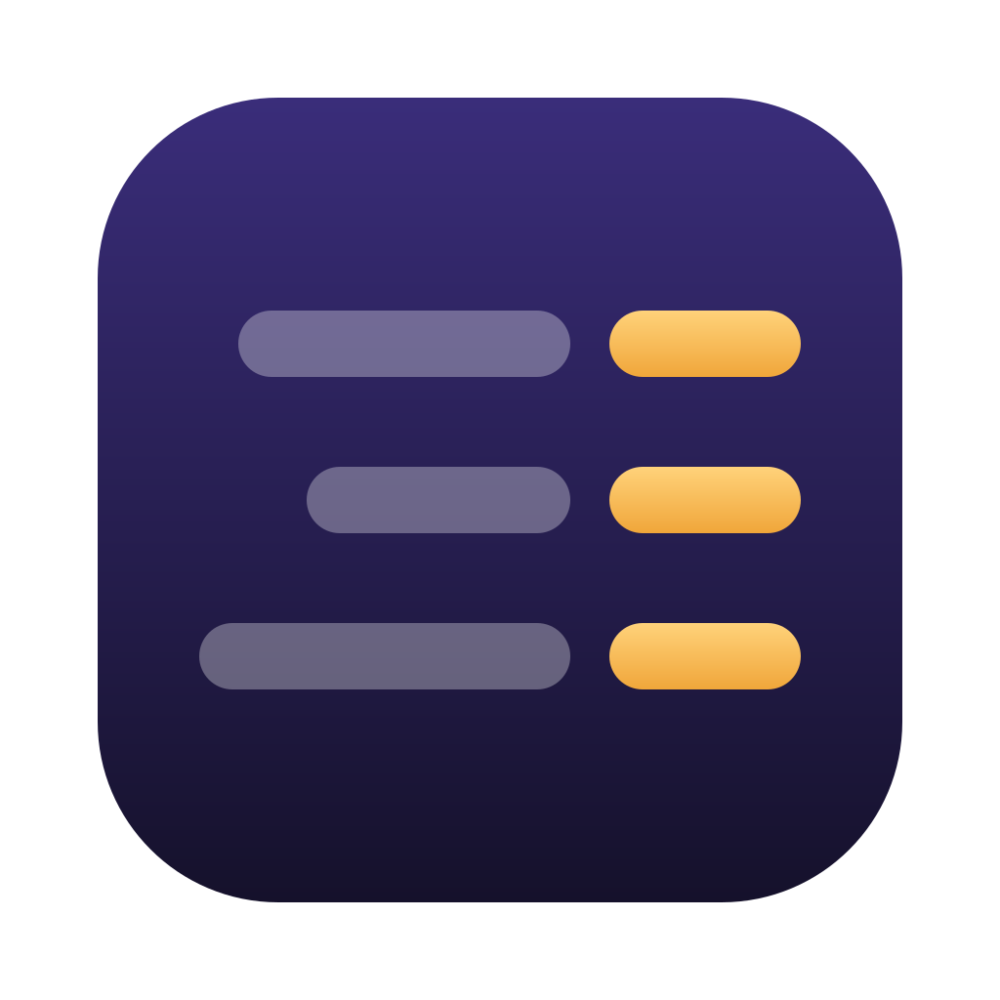
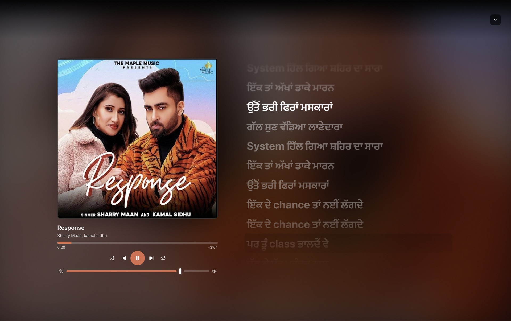
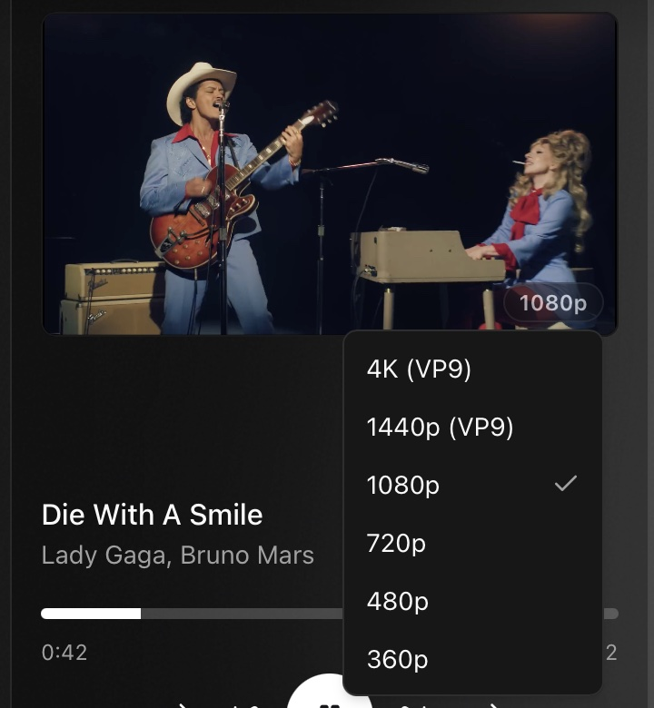

<div align="center">
  

  <h1>Radif</h1>

  <p><em>A YouTube Music app for the Mac.</em></p>

  <p>
    
    
    
  </p>

  <p>
    <a href="#install">Install</a> ·
    <a href="#what-it-does">What it does</a> ·
    <a href="#building-it-yourself">Building it</a>
  </p>

  <a href="../../releases/latest">
    
  </a>

  <br /><br />

  
</div>

<br />

Radif plays YouTube Music in its own Mac window instead of a browser tab. It
talks to YouTube Music's API and draws its own interface rather than wrapping
the website, so media keys work and Now Playing shows up in Control Center.

It is Mac only. Songs still in its local cache play without downloading
again, audio comes at up to 271 kbps Opus, and the notch can show what's
playing.

**You need YouTube Music Premium.** On a free account it won't play songs. It
shows a Premium prompt instead of serving ads.

## Install

With [Homebrew](https://brew.sh) it's one line, and it installs Deno and skips
the Terminal step below:

```bash
brew install --cask yuvrajangadsingh/tap/radif
```

Then sign in with the Google account that has YouTube Music Premium.

Without Homebrew:

**1.** [Download the `.dmg`](../../releases/latest) and open it.

**2.** Drag **Radif** onto the Applications folder.

**3.** Open it. macOS refuses with *"Apple could not verify Radif is free of
malware"*, because the app isn't signed with Apple's $99-a-year certificate.
Open **Terminal** and paste:

```bash
xattr -cr /Applications/Radif.app
```

That clears the app's extended attributes, including the "downloaded from the
internet" flag that causes the block. After that it opens normally.

**4.** Sign in with the Google account that has YouTube Music Premium.

**5.** For full-quality audio, install [Deno](https://deno.com) (`brew install
deno`). The app finds it on its own. Without it most songs play at about
130 kbps.

The same download runs on Intel and Apple Silicon. It updates itself: a banner
in the sidebar offers each new version, one click installs it and another
restarts into it. On first launch the app downloads yt-dlp (about 50 MB), so
the first song waits for that.

<details>
<summary>I'd rather not touch Terminal</summary>

Try to open Radif and let macOS block it. Then go to **System Settings →
Privacy & Security** and scroll down. There's a line about Radif being blocked,
with an **Open Anyway** button.

</details>

<details>
<summary>Playback suddenly stopped working</summary>

YouTube changes its streaming internals now and then, and playback breaks
until yt-dlp ships a fix, usually within days. The app checks for a new yt-dlp
when it launches, at most once every three days.

</details>

## What it does

The fullscreen player shows the cover and synced lyrics over a backdrop taken
from the artwork, and it crossfades when the track changes. Lyrics come from
YouTube Music, LRCLIB, Musixmatch and Genius. The app checks that a result is
for the song that's playing, prefers timed lyrics, and tries to shift the
timing when an upload has a padded intro.

Video mode plays the music video for a track, with a quality picker from 360p
up to 4K.



On a Mac with a notch, the song title can slide out of it when a track starts,
pauses or resumes. It's off by default; turn it on in Settings.


Also: in the side and fullscreen players the seek bar and buttons take their
colour from the cover, cover art is upgraded to a high-resolution version when
one exists, and recent searches are kept. The player can sit along the bottom,
on the right, or in a small window you can pin on top. Playlists, likes,
albums, artists, search with filters and radio are all there, and media keys
and Now Playing stay in sync with the app both ways.

> Radif is an unofficial client. It isn't affiliated with, endorsed by, or
> sponsored by Google or YouTube. "YouTube" and "YouTube Music" are trademarks
> of Google LLC. Audio streams through [yt-dlp](https://github.com/yt-dlp/yt-dlp)
> and can break when YouTube changes its internals. Use at your own risk.

## Building it yourself

You need Node 20+, Rust and pnpm.

```bash
pnpm install
pnpm tauri dev            # run it
pnpm tauri build --bundles app,dmg   # build a .dmg
```

The build lands in `src-tauri/target/release/bundle/`. The `develop` branch is
set to sign with a local dev certificate, so build it with
`--config '{"bundle":{"macOS":{"signingIdentity":"-"}}}'` instead. If you give
the app to someone else and their Mac says "Radif is damaged", sign it ad hoc:

```bash
codesign --force --deep --sign - Radif.app
```

<details>
<summary>Checks, stack, and layout</summary>

```bash
pnpm test         # vitest unit tests
pnpm lint         # eslint
pnpm format       # prettier --write
pnpm build        # tsc + vite production build
```

CI (`.github/workflows/ci.yml`) runs the build, typecheck, lint, tests and
the Rust tests on every PR and every push to main.

Tauri 2 (Rust backend, WKWebView on macOS) with React 19 and TypeScript, built
with Vite 7, styled with Tailwind v4 and shadcn/ui, TanStack Router and Query,
and Zustand for client state.

```
src/
├── routes/              # TanStack Router file-based routes
├── components/
│   ├── ui/              # shadcn primitives
│   ├── layout/          # AppShell, sidebar, topbar, player bar, floating player, lyrics
│   └── shared/          # Track list/rows, cards, shelves, context menus
├── lib/
│   ├── innertube/       # Raw InnerTube client + parsers
│   ├── lyrics/          # Lyrics sources + LRC parser
│   ├── store/           # Zustand stores
│   ├── audio-engine.ts  # Playback engine
│   └── stream.ts        # Stream URL resolver (localhost proxy)
└── hooks/
src-tauri/               # Rust backend (axum stream proxy, cookies, media session)
```

</details>

## Credits

Radif started in July 2026 as a fork of [YTubic](https://github.com/NUber-dev/YTubic)
by [@NUber-dev](https://github.com/NUber-dev), and has been its own project
since August. Most of the app is built on their work.

Thanks to [yt-dlp](https://github.com/yt-dlp/yt-dlp) for audio streaming,
[LRCLIB](https://lrclib.net), Musixmatch and Genius for lyrics, and
[Tauri](https://tauri.app), [shadcn/ui](https://ui.shadcn.com) and
[TanStack](https://tanstack.com).

The name: a radif is the refrain in a ghazal, the words every couplet comes
back to.

## License

[GPL-3.0](LICENSE). Free to use, change and share. If you distribute a version
you changed, its source has to be available under the same license. The original copyright and license stay intact.
